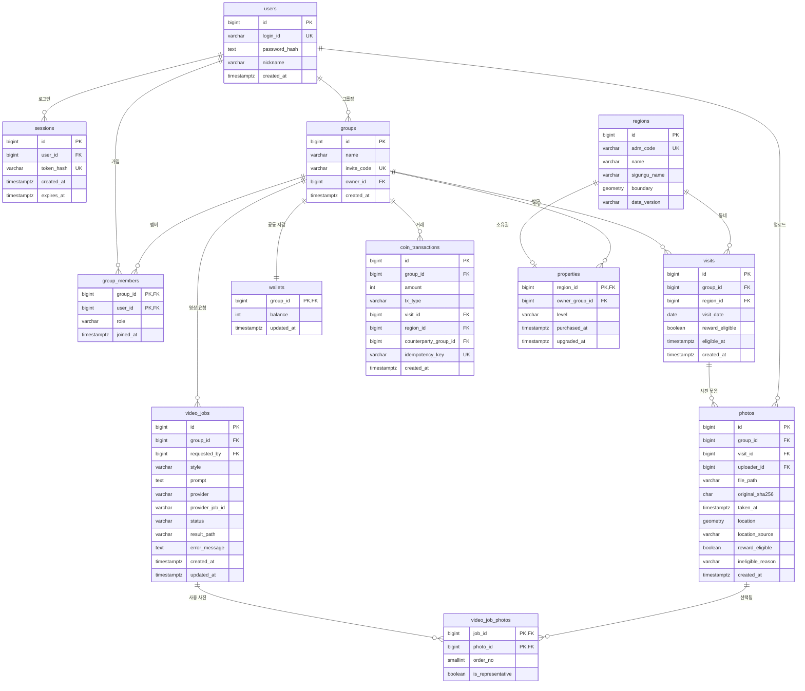

# ERD 초안

> 작성: 승민 (DB·백엔드) · 상태: 초안 · 기준 문서: 6주 개발 기획안 "최소 DB"
> ★ 표시는 2주차(로그인 → 그룹 → 사진 업로드 → 동네 1곳 표시)에 바로 필요한 테이블입니다.

## 전체 관계도

## 테이블별 설명과 제약조건

### ★ users — 계정
| 컬럼 | 타입 | 제약 | 설명 |
| --- | --- | --- | --- |
| id | BIGSERIAL | PK | |
| login_id | VARCHAR(30) | UNIQUE, NOT NULL | 로그인 아이디 |
| password_hash | TEXT | NOT NULL | 비밀번호 원문은 저장하지 않음 |
| nickname | VARCHAR(30) | NOT NULL | 화면 표시 이름 |
| created_at | TIMESTAMPTZ | NOT NULL, DEFAULT now() | |

### ★ sessions — 로그인 상태 (서버 세션 + HttpOnly 쿠키)
| 컬럼 | 타입 | 제약 | 설명 |
| --- | --- | --- | --- |
| id | BIGSERIAL | PK | |
| user_id | BIGINT | FK → users, NOT NULL, ON DELETE CASCADE | |
| token_hash | VARCHAR(64) | UNIQUE, NOT NULL | 쿠키 토큰의 해시만 저장 |
| created_at | TIMESTAMPTZ | NOT NULL | |
| expires_at | TIMESTAMPTZ | NOT NULL | 만료 후 무효 |

### ★ groups — 친구 그룹
| 컬럼 | 타입 | 제약 | 설명 |
| --- | --- | --- | --- |
| id | BIGSERIAL | PK | |
| name | VARCHAR(30) | NOT NULL | |
| invite_code | VARCHAR(12) | UNIQUE, NOT NULL | 초대 코드 |
| owner_id | BIGINT | FK → users, NOT NULL | 그룹장 (구매·업그레이드 권한) |
| created_at | TIMESTAMPTZ | NOT NULL | |

### ★ group_members — 그룹 소속
| 컬럼 | 타입 | 제약 | 설명 |
| --- | --- | --- | --- |
| group_id | BIGINT | PK, FK → groups | |
| user_id | BIGINT | PK, FK → users | |
| role | VARCHAR(10) | CHECK (role IN ('owner','member')) | |
| joined_at | TIMESTAMPTZ | NOT NULL | |

- 복합 PK (group_id, user_id) → **같은 그룹 중복 가입 방지**
- 모든 그룹 데이터 API는 "요청자가 이 그룹의 멤버인가"를 이 테이블로 확인 → **타 그룹 접근 차단**

### ★ regions — 행정동 (수원시 1차)
| 컬럼 | 타입 | 제약 | 설명 |
| --- | --- | --- | --- |
| id | BIGSERIAL | PK | |
| adm_code | VARCHAR(10) | UNIQUE, NOT NULL | 행정동 코드 (지도 담당과 공유하는 키) |
| name | VARCHAR(30) | NOT NULL | 예: 영통1동 |
| sigungu_name | VARCHAR(30) | NOT NULL | 예: 수원시 영통구 |
| boundary | geometry(MultiPolygon, 4326) | NOT NULL, GIST 인덱스 | 위치 판정용 원본 경계 |
| data_version | VARCHAR(20) | NOT NULL | 경계 데이터 버전 (화면용 경계와 일치시킴) |

- 동네 판정: `ST_Contains(boundary, 사진좌표)` — 서버(PostGIS)가 최종 판정
- 후보가 2개 이상이거나 없으면 보상 보류 / 지원 지역 외 처리

### ★ visits — 방문 (그룹·날짜·동네 단위)
| 컬럼 | 타입 | 제약 | 설명 |
| --- | --- | --- | --- |
| id | BIGSERIAL | PK | |
| group_id | BIGINT | FK → groups, NOT NULL | |
| region_id | BIGINT | FK → regions, NOT NULL | |
| visit_date | DATE | NOT NULL | KST 기준 촬영일 |
| reward_eligible | BOOLEAN | NOT NULL, DEFAULT false | 보상 대상 방문 여부 |
| eligible_at | TIMESTAMPTZ | NULL | 보상 대상으로 처음 인정된 시각 (첫 방문 판정 순서) |
| created_at | TIMESTAMPTZ | NOT NULL | |

- **UNIQUE (group_id, visit_date, region_id)** → 같은 그룹·같은 날·같은 동네는 사진이 여러 장이어도 방문 1회
- 수동 방문은 reward_eligible = false로 시작, 유효 사진이 추가되면 **한 번만** true로 전환
- 방문 농도(1 / 2 / 3–4 / 5–9 / 10+)는 그룹·동네별 COUNT로 계산

### ★ photos — 정제된 사진
| 컬럼 | 타입 | 제약 | 설명 |
| --- | --- | --- | --- |
| id | BIGSERIAL | PK | |
| group_id | BIGINT | FK → groups, NOT NULL | |
| visit_id | BIGINT | FK → visits, NOT NULL | |
| uploader_id | BIGINT | FK → users, NOT NULL | |
| file_path | VARCHAR(255) | NOT NULL | media_data 볼륨 내 정제본 경로 (GPS 제거됨) |
| original_sha256 | CHAR(64) | NOT NULL | 원본 해시 (원본 파일은 폐기) |
| taken_at | TIMESTAMPTZ | NULL | EXIF 촬영 시각, 없으면 NULL |
| location | geometry(Point, 4326) | NULL | 서버가 읽은 좌표, 없으면 NULL |
| location_source | VARCHAR(10) | CHECK IN ('exif','manual') | |
| reward_eligible | BOOLEAN | NOT NULL | 이 사진이 보상 근거가 되는지 |
| ineligible_reason | VARCHAR(30) | NULL | 예: no_gps, out_of_area, future, older_than_30d |
| created_at | TIMESTAMPTZ | NOT NULL | |

- **UNIQUE (group_id, original_sha256)** → 같은 사진 재업로드로 중복 집계 방지

### wallets — 그룹 공동 지갑
| 컬럼 | 타입 | 제약 | 설명 |
| --- | --- | --- | --- |
| group_id | BIGINT | PK, FK → groups | 그룹당 지갑 1개 |
| balance | INT | NOT NULL, DEFAULT 0, **CHECK (balance >= 0)** | 잔액 음수 금지 |
| updated_at | TIMESTAMPTZ | NOT NULL | |

### coin_transactions — 거래 원장 (삭제·수정하지 않음)
| 컬럼 | 타입 | 제약 | 설명 |
| --- | --- | --- | --- |
| id | BIGSERIAL | PK | |
| group_id | BIGINT | FK → groups, NOT NULL | 이 거래의 지갑 주인 |
| amount | INT | NOT NULL, CHECK (amount <> 0) | +입금 / −출금 |
| tx_type | VARCHAR(20) | CHECK IN ('first_visit','revisit','buy_building','upgrade_landmark','toll_paid','toll_received') | |
| visit_id | BIGINT | FK → visits, NULL | 방문 보상·통행료 근거 |
| region_id | BIGINT | FK → regions, NULL | 구매·업그레이드·통행료 대상 동네 |
| counterparty_group_id | BIGINT | FK → groups, NULL | 통행료 상대 그룹 |
| idempotency_key | VARCHAR(80) | UNIQUE, NOT NULL | 예: `reward:visit:123` → **중복 보상 방지** |
| created_at | TIMESTAMPTZ | NOT NULL | |

- 통행료는 거래 2건(toll_paid −N, toll_received +N)을 **한 트랜잭션**에서 기록 → 차감액 = 입금액
- wallets.balance 갱신과 원장 기록은 항상 같은 트랜잭션

### properties — 동네 소유권
| 컬럼 | 타입 | 제약 | 설명 |
| --- | --- | --- | --- |
| region_id | BIGINT | PK, FK → regions | PK라서 **동네당 소유 그룹은 하나** |
| owner_group_id | BIGINT | FK → groups, NOT NULL | |
| level | VARCHAR(10) | CHECK IN ('building','landmark') | 건물 100 → 랜드마크 업그레이드 80 |
| purchased_at | TIMESTAMPTZ | NOT NULL | |
| upgraded_at | TIMESTAMPTZ | NULL | |

- 동시 구매 시 PK 충돌로 한 그룹만 성공

### video_jobs — 영상 생성 작업
| 컬럼 | 타입 | 제약 | 설명 |
| --- | --- | --- | --- |
| id | BIGSERIAL | PK | |
| group_id | BIGINT | FK → groups, NOT NULL | |
| requested_by | BIGINT | FK → users, NOT NULL | |
| style | VARCHAR(10) | CHECK IN ('cinematic','anime','natural','funny') | 영화처럼/애니처럼/자연스럽게/웃기게 |
| prompt | TEXT | NULL | |
| provider | VARCHAR(20) | NOT NULL | 실제 제공자 또는 'mock' |
| provider_job_id | VARCHAR(100) | NULL | 제출 직후 저장 → 재시작 시 조회 우선, 중복 과금 방지 |
| status | VARCHAR(12) | CHECK IN ('queued','generating','editing','completed','failed') | |
| result_path | VARCHAR(255) | NULL | 완성 영상 경로 |
| error_message | TEXT | NULL | |
| created_at / updated_at | TIMESTAMPTZ | NOT NULL | |

### video_job_photos — 영상에 쓰인 사진
| 컬럼 | 타입 | 제약 | 설명 |
| --- | --- | --- | --- |
| job_id | BIGINT | PK, FK → video_jobs | |
| photo_id | BIGINT | PK, FK → photos | |
| order_no | SMALLINT | NOT NULL, CHECK (order_no BETWEEN 1 AND 5) | |
| is_representative | BOOLEAN | NOT NULL | AI 클립을 만들 대표 사진 |

- UNIQUE (job_id, order_no)
- 대표 사진은 작업당 1장: `CREATE UNIQUE INDEX ... ON video_job_photos (job_id) WHERE is_representative`

## 팀 논의가 필요한 점
1. **photos.location 저장 여부** — 저장 파일에서는 GPS를 지우지만, DB에 좌표를 남길지(재판정·디버깅용) 동네 코드만 남길지 결정 필요
2. **regions.adm_code 형식** — 지도 담당(희재)이 쓰는 행정동 데이터(admdongkor)의 코드 자리수와 맞추기
3. **세션 만료 기간** — 예: 7일
4. **사진 삭제 시** — 기획안대로 코인·소유권은 되돌리지 않음. photos 행을 지울지, 삭제 표시만 할지 결정 필요
